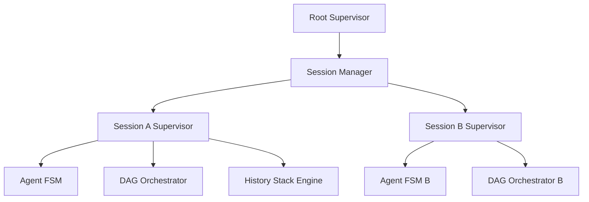

# ProCoder

## Chapter 1:

### 1.1 The Vision: Beyond Assisted Programming
ProCoder is a **recursive, autonomous software engineer**. It is designed to inhabit, understand, and evolve complex codebases with the same architectural foresight and technical precision as a senior lead engineer. The vision behind ProCoder is the realization of **Autonomous Software Synthesis (ASS)**—a state where the machine is no longer just a participant in the coding process, but the primary driver of architectural evolution, bug resolution, and system-wide refactoring.

### 1.2 The Core Design Goals
The architecture of ProCoder is anchored by four fundamental pillars that define its operational behavior and cognitive logic:

#### I. High-Fidelity Architectural Precision
ProCoder does not operate on text alone. Through its **Cognitive Digital Modelling System (CDMS)**, it constructs a rich, multi-dimensional graph of the entire software ecosystem. It understands the "why" behind a module, the hidden dependencies between services, and the cascading impact of a single logic change. Every action ProCoder takes is informed by this global context, ensuring that its interventions are structurally sound and architecturally coherent.

#### II. Recursive Self-Evolution (Experimental)
A static agent is a dead agent. ProCoder is built to self-improve. Using its **Mastery SDK and Macro DSL**, ProCoder can synthesize new "Specialist" agents at runtime, forge custom skills to handle novel technologies, and audit its own cognitive history to identify and break out of reasoning loops. The system is designed to become more intelligent and efficient with every session it completes. (Pls note that this feature is still under development).

#### III. Absolute Transactional Safety
Autonomous agency requires hardened guardrails. ProCoder implements a **Multi-Layered Security Lattice**. From the **Policy Engine** that evaluates risk heuristics at the byte-level to the **Git-backed Worktree isolation** that ensures every modification is transactional and revertible, ProCoder is built for production environments where "breaking things" is not an option.

#### IV. Mathematical Agency & Salience
Cognition in ProCoder is a resource-weighted operation. The system employs **Salience Ranking** and **Salience-Weighted History Management** to ensure that the agent's limited context window is always populated with the highest-relevance information. We replace raw "memory" with "intelligence," filtering out the noise of dependency graphs and build artifacts to focus on the core logic that matters.

### 1.3 The "ProCoder" Identity
When you activate a ProCoder instance, you are commissioning a persona. The ProCoder Identity is defined by:
- **Radical Transparency**: The agent documents its "Chain of Thought" reasoning before every action.
- **Structural Integrity**: It prioritizes the health of the codebase over the speed of the fix.
- **Reflective Verification**: It never "presumes" success; it follows a strict protocol of Proof-of-Work verification before submitting its findings.

ProCoder is the bridge between the human intent and the synthesized reality of perfectly engineered software.

---

## Chapter 2: Architectural Hierarchy & Domain Genesis

### 2.1 The Supervision Tree: A Fractal Fortress
ProCoder is built on the Elixir/OTP actor model, utilizing a deeply nested supervision tree to ensure fault tolerance and high availability. Unlike monolithic agent systems, ProCoder decomposes its cognitive and operational tasks into isolated processes, each managed by a supervisor that enforces strict restart strategies.

#### The Root Supervisor (`ProCoder.SupervisionTree.RootSupervisor`)
The apex of the system. It initializes the core infrastructure:
- **Registry**: Global name resolution for sessions, agents, and planners.
- **SessionManager**: Orchestrates the lifecycle of autonomous workspaces.
- **ControlPlane**: Management of the UI, API Gateway, and Command Router.
- **MemorySupervisor**: Oversight of persistent and ephemeral data stores.

#### Fractal Isolation
Each session spawned by the `SessionManager` generates its own isolated supervision subtree:

This fractal isolation ensures that a crash in one agent's reasoning (e.g., a logic error in a custom skill) never compromises the stability of the entire ProCoder cluster.

### 2.2 Domain Decomposition
The system is divided into four primary functional domains, each with a clear separation of concerns:

#### Domain I: The Actuator (Execution Layer)
The Actuator is the system's "hands." It is responsible for all interactions with the physical environment (filesystem and shell).
- **Hardened IO**: All file operations are mediated by the `AgentIO` module, which enforces path containment and atomic writes.
- **PortWrapper**: A security-hardened bridge to the OS shell, utilizing Bubblewrap-inspired isolation to prevent unauthorized system access.
- **Policy Engine**: A real-time heuristic monitor that evaluates the risk score of every command. If an agent attempts an operation with a risk score exceeding the configured threshold (e.g., `rm -rf /`), the Actuator triggers an immediate supervisor-level intervention.

#### Domain II: The Brain (Cognitive Layer)
The Brain is the "prefrontal cortex." It manages the interface between the agent and the Large Language Model (Gemini).
- **Gemini Adapter**: A specialized implementation of the `LLMClient` that utilizes native Function Calling. It translates the FSM's intent into typed `function_declarations` and handles 429 rate-limiting via exponential backoff rotation.
- **Salience Ranker**: A semantic filtering engine that ranks context segments (code chunks, history turns) based on their utility to the current goal. This ensures the 1.0M+ token context window is utilized with maximum efficiency.
- **Prompt Orchestrator**: The central hub that assembles the final prompt payload, injecting system instructions, salience-ranked context, and multi-turn history.

#### Domain III: The Planner (Orchestration Layer)
The Planner is the "executive function." It manages the decomposition of complex goals into executable tasks.
- **DAG Orchestrator**: A graph-based engine (`libgraph`) that models task dependencies. Tasks are added to the Directed Acyclic Graph during the planning phase and executed sequentially or in parallel during synthesis.
- **Failure Remediator**: A self-healing mechanism that detects task failures and automatically injects "compensation tasks" into the DAG to rectify the state.
- **GraphValidator**: Ensures the structural integrity of the execution plan, preventing circular dependencies and unreachable state nodes.

#### Domain IV: The Core (Lifecycle Layer)
The Core is the "nervous system." It maintains the state and identity of the agent.
- **AgentFSM**: A `gen_statem` controller that implements the agent lifecycle:
  1. **Discovery**: Mapping the environment and identifying targets.
  2. **Planning**: Synthesizing the DAG and established dependencies.
  3. **Synthesis**: Sequential tool execution and batch verification.
  4. **Verification**: Peer-audit and reflective goal mapping.
- **Worktree Manager**: Manages ephemeral Git worktrees for transactional logic updates. Every modification is staged in a sandbox before being committed to the main branch.

### 2.3 The Native Function Calling Loop
ProCoder bypasses the fragility of JSON-in-markdown parsing by utilizing the Gemini 2.5/3.1 native function calling mode (`mode: ANY`).
1. The **FSM** requests a cognitive turn.
2. The **Adapter** sends current tools as JSON Schema declarations.
3. The **LLM** returns a structured `functionCall` part (and an optional `thought` part).
4. The **Actuator** executes the tool and returns a `functionResponse`.
5. The **FSM** integrates the response into its history and decides on the next state transition.

This loop is executed with millisecond precision, enabling complex, multi-turn reasoning chains that are 100% deterministic.


## Chapter 3: Cognitive Memory & Neural Context

ProCoder's cognitive performance is fundamentally tied to its ability to manage, recall, and prioritize Information. Traditional agent architectures often suffer from "Context Exhaustion" or "Associative Fog"—the inability to distinguish critical architectural patterns from transient build noise. ProCoder solves this through a sophisticated, multi-tiered neural context system.

### 3.1 The Two-Tiered Memory Architecture
Memory in ProCoder is divided into two operational tiers: a high-frequency "Hot Stack" for active reasoning and a durable "Cold Storage" for long-term cognitive continuity.

#### I. The Hot Stack (ETS)
Managed by the `ProCoder.Memory.ContextStore`, the Hot Stack utilizes Erlang Term Storage (ETS) to provide microsecond-latency access to session-local context.
- **Table Structure**: Each session uses a private `cache_<session_id>` table (ordered_set).
- **Injected Context**: When an agent "reads" a file, the content is injected into ETS with a TTL and a salience metadata tag.
- **Eviction Strategy**: As the task progresses, the `ContextStore` automatically evicts low-salience segments to prevent memory bloat, following a Least-Recently-Used (LRU) pattern.

#### II. Cold Storage (SQLite & Ecto)
For persistence across restarts and for forensic auditing, ProCoder utilizes a hardened SQLite backend.
- **Snapshots Table**: Stores the binary-serialized state of the agent (`memory_blob`) at key decision points.
- **Sessions Table**: Maintains the high-level metadata (Goal, Start Time, System Status) of every commissioned agent.
- **Integrity Validation**: Every cold-storage record is protected by a SHA-256 checksum, ensuring that cognitive state restoration (`/rewind`) is always performed on uncorrupted data.

### 3.2 The HistoryStackEngine: LIFO Cognitive Logic
The `ProCoder.Core.HistoryManagement.RewindManager.StackEngine.HistoryStackEngine` is the primary orchestrator of the agent's turn-by-turn history. It enforces a strict Last-In-First-Out (LIFO) protocol for state snapshots.

| Component | Responsibility | Performance Target |
|-----------|----------------|-------------------|
| **Hot Cache** | Immediate turn-by-turn recall | < 1ms |
| **Commit Logic** | Calculating SHA-256 hashes for state snapshots | < 5ms |
| **Flush Logic** | Periodic background sync to SQLite | Asynchronous |
| **Rewind Logic** | Transactional restoration of memory + filesystem | < 500ms |

### 3.3 Salience-Driven Context Pruning
One of ProCoder's most advanced features is its ability to "forget" the irrelevant while "clinging" to the essential. This is handled by the **Saliency Ranking System**.

#### The Salience Score (S)
The importance of a context segment is calculated using a dynamic heuristic:
```text
S = (Importance_Weight * Relevance_to_Goal) / (Recency_Decay * token_count^0.5)
```
- **Importance_Weight**: Constants assigned to file types (e.g., `mix.exs` has higher base salience than `README.txt`).
- **Relevance_to_Goal**: Similarity between the context segment and the current session goal (Vector Semantic Similarity).
- **Recency_Decay**: A time-decay factor that prioritizes information from the most recent turns.

#### The Pruning Pipeline
1. **Saturation Detection**: The `Orchestrator` monitors the token count of the history array.
2. **Ranking**: When tokens exceed 80% of the model's budget (~800k tokens for Gemini 2.5 Pro), the `SalienceRanker` is invoked.
3. **Dropping**: Segments with the lowest `S` scores are dropped until the budget is satisfied.
4. **Emergency Pruning**: If the prompt assembly still fails due to size, the system triggers a fallback "Structural-Only" mode, dropping all code content and retaining only file paths and module summaries to allow the agent to retain its "map."

### 3.4 Cognitive Forensics & Time Travel
Through the `ReflexiveAuditSkill`, ProCoder can perform "Time Travel" queries. An agent can ask itself: *"What was I thinking 10 turns ago before I applied that patch?"*

The system reconstructs the past state by:
1. Identifying the target `snapshot_id` in the `Repo`.
2. Verifying the `integrity_hash`.
3. Loading the `memory_blob` back into the `AgentFSM`.
4. (Optional) Reverting the git worktree to the associated `git_commit` hash.

This diagnostic depth is what allows ProCoder to solve complex, multi-day engineering challenges that would overwhelm a standard context-less agent.

---

## Chapter 4: The CDMS Doctrine — Neural Discovery & Spreading Activation

The **Cognitive Digital Modelling System (CDMS)** is the pre-symbolic "intuition" layer of ProCoder. While compilers see syntax, CDMS sees the **Neural Topography** of the codebase, allowing agents to navigate via associative reasoning and functional salience. 

### 4.1 The CDMS Architecture: Generative Grounding
At the heart of CDMS is the external `cdms` daemon, a high-performance cognitive engine running in `generative` mode on port `5115`. 
- **The Neural Twin**: Unlike static indices, CDMS maintains a live, volatile model of the project's intent. It is started by the `ProCoder.Tooling.CDMSDaemon` with the `--mode generative` flag, enabling it to bridge the gap between raw source and conceptual meaning.
- **NodeActors**: Every architectural concept is represented as an actor. When an agent "tasks" a concept, the CDMS triggers **Spreading Activation**, stimulating related nodes across the graph regardless of text-based similarity.

### 4.2 Spreading Activation & Discovery
CDMS solves the "Unknown Unknowns" problem. 
1. **Stimuli**: The agent injects a "Cognitive Stimulus" (e.g., "Authentication Flaw") into the graph.
2. **Propagation**: Activation energy flows through semantic edges. A stimulus at the `OAuth` node will automatically "light up" the `TokenValidator`, `SessionStore`, and `CryptoHeader` modules.
3. **Ghost Nodes**: CDMS tracks "Ghost Nodes"—historical traces of architectural decisions that are no longer in the active source but reflect the *intent* of the system's design. This allows the agent to reason about the *why* even after the *how* has changed.

### 4.3 Cognitive Telemetry & Metabolism
The metabolic health of the cognitive model is monitored via a WebSocket stream (`ws://localhost:5115/api/v1/events`):
- **High Energy Activation**: If a search query triggers an unexpected surge in graph stimulation, the `ProCoder.Actuator.CDMSTelemetry` captures an `abnormality_signal`. 
- **Cognitive Dissonance**: This telemetry alerts the agent when its proposed architectural changes conflict with the established "Neural Pulse" of the codebase, triggering a reflective audit before the code is written.

### 4.4 Forensic Mutation Ledgers
CDMS keeps a ledger of all mutation events. Through `cdms_time_travel`, an agent can reconstruct the evolution of a logic branch.
- **Mutation Streams**: See all graph changes in the last X minutes.
- **Chrono-Chains**: View the version history of a single node as a series of semantic diffs.
- **Historical Search**: Run a query against the state of the graph at a specific point in time (e.g., *"What did the auth system look like before the v2.0 migration?"*).

---

## Chapter 5: The CodeGraph Engine — Symbolic Precision & AST Forensics

While CDMS provides the intuition, the **CodeGraph Engine** provides the surgical, mathematical precision required for modification. It is the **Symbolic Layer** of ProCoder's understanding.

### 5.1 High-Performance NIF Architecture
The CodeGraph is powered by **Rustler-backed NIFs** (`ProCoder.Search.CodeGraph.Native`) that interface directly with the **Tree-Sitter** parsing ecosystem.
- **Microsecond Parsing**: Leveraging Rust's safety and speed, ProCoder parses source files into Abstract Syntax Trees (ASTs) at near-native speeds.
- **Multi-Language Support**: The engine ships with optimized grammars for Elixir, Javascript, Typescript, Python, C++, Rust, and more.

### 5.2 Relationship Forensics: The Symbolic Web
The `CodeGraphEngine` extracts a deterministic graph of facts:
- **`defines`**: Mapping files to the modules and functions they provide.
- **`calls`**: A comprehensive call-graph mapping every cross-module invocation.
- **`depends_on`**: Extraction of `alias`, `import`, `require`, and `use` directives.
- **Logic Identification**: specialized detection logic in `extract_relationships/2` identifies complex patterns like `is_defmodule_call?` or `find_module_in_dot_call`, ensuring that dynamic Elixir code is correctly indexed.

### 5.3 Vector-Symbolic Hybrid Search (VSS)
ProCoder merges symbolic facts with vector similarity via **`sqlite-vec`**.
- **The VSS Table**: `vss_code_nodes` stores 384-dimensional embeddings of code chunks generated by the `EmbeddingWorker`.
- **Hybrid Retrieval**: The search coordinator can perform queries like: *"Find all high-salience chunks (Vector) that are children of the Actuator supervisor (Symbolic)."*
- **Incremental Indexing**: Uses SHA-256 content hashing to ensure the graph only re-indexes what has changed, maintaining a sub-second "Hot Graph" for large-scale codebases.

### 5.4 Functional Certainty
Through the CodeGraph, the agent achieves **Symbolic Certainty**. It doesn't "guess" if a function is called somewhere else; it queries the `code_relationships` table to see the mathematical truth.

---

## Chapter 6: Control Plane & Operational TUI

The **Control Plane** is the "Central Nervous System" of the ProCoder interactive experience. It orchestrates the flow of data between the user, the autonomous agents, and external integrated tools. ProCoder provides a high-performance, real-time command-line interface (TUI) that allows for seamless human-in-the-loop (HITL) collaboration.

### 6.1 The Control Plane Hierarchy
The `ProCoder.ControlPlane.Supervisor` manages a suite of mission-critical services that handle interaction and routing:

| Service | Module | Purpose |
|---------|--------|---------|
| **Command Router** | `ProCoder.UI.RoutingLayer.CommandRouter` | Dispatches incoming commands to the appropriate agent or system handler. |
| **TUI View** | `ProCoder.UI.ViewLayer.TuiView` | Manages the interactive REPL and the `Owl`-based screen rendering. |
| **Endpoint** | `ProCoder.ControlPlane.LocalServer.Endpoint` | Provides an HTTP/WebSocket gateway for external IDE plugins or web dashboards. |

### 6.2 The Operational TUI: REPL Redefined
ProCoder's TUI is built on the **Owl** library, providing a rich, colorized, and responsive environment for agent supervision.

#### Key Features of the TUI:
- **Bracketed Paste Support**: Safely handle large blobs of code pasted directly into the prompt.
- **Multimodal State Feedback**: Real-time status updates (e.g., "[THINKING]", "[PLANNING]", "[DISCOVERING]") displayed with specific color hex-codes.
- **Interactive Slash Commands**: A robust command system for manual overrides and session management.

#### Common Slash Commands:
- `/new`: Gracefully terminates the current session and commissions a fresh workspace.
- `/rewind <snapshot_id>`: Triggers a transactional rollback of the agent's cognitive and filesystem state.
- `/list`: Displays the session archive with semantic titles and timestamps.
- `/reload <session_id>`: Re-hydrates a past session from cold storage, restoring the full history and worktree.
- `/audit`: Invokes the `ReflexiveAuditSkill` to review the agent's recent reasoning chain.
NOTE that although the most fundamental commands are fully functional some are still being developed and may not behave exactly as expected.

### 6.3 The Local Server API: Beyond the CLI
While the TUI is the primary interface for developers, the `LocalServer.Endpoint` allows ProCoder to act as a backend for the broader engineering ecosystem.
- **REST Gateway**: Standard HTTP endpoints for spawning agents (`POST /spawn`), searching the CodeGraph (`POST /search`), and checking system health (`GET /health`).
- **LSP Bridge**: Interfaces with Language Server Protocol (LSP) providers to augment the agent's understanding with real-time compilation and type-checking data.
- **Telemetry Stream**: Emitters that push operational events to external monitors (e.g., Prometheus, Grafana) for fleet-level agent observability.

### 6.4 The Transactional Diff Viewer Protocol
One of the most sensitive operations in ProCoder is the application of code changes. The **Diff Viewer** (`ProCoder.UI.ViewLayer.DiffViewer`) implements a strict transactional protocol for user review.

1. **Generation**: The agent generates a unified diff (`patch_file`) or a full file rewrite (`write_file`).
2. **Staging**: The change is applied to the ephemeral git worktree, and a multi-dimensional diff is calculated.
3. **Review**: The TUI renders a colorized diff using the **Owl** logic engine.
   - **(y)es**: Commits the change and advances the agent's lifecycle.
   - **(n)o**: Rejects the change, injecting the user's feedback into the agent's history for an immediate "Remediation Cycle."
   - **(e)dit**: Suspends the agent and opens the target file in the user's default `$EDITOR` (VS Code, Vim, etc.) for manual adjustment.

### 6.5 Session Lifecycle Orchestration
The Control Plane coordinates with the `SessionManager` to ensure that "Zombie Agents" are purged and computing resources are recycled.
- **Graceful Termination**: When a session is concluded via `submit_for_validation`, the Control Plane triggers a final archival flush.
- **Emergency Suspension**: If a system-wide fault is detected (e.g., API key expiration), the Control Plane can broadcast a `:suspend` signal to all active agent processes, freezing their state until the environment is restored.

The Control Plane ensures that while the agent is autonomous, it remains fully visible, auditable, and controllable by the human engineer.

## Chapter 7: The Mastery SDK

ProCoder is designed for **Unlimited Extensibility**. While the base agent is powerful, the true potential of the system is realized through the **Mastery SDK**—a suite of Elixir Macros and runtime compilation logic that allows you (or ProCoder itself) to forge specialized agents and custom skills dynamically.

### 7.1 The ProCoder Macro DSL
The SDK provides a high-level, declarative Domain Specific Language (DSL) that abstract away the complexities of GenServer initialization, state management, and tool registration.

#### I. The `defagent` Macro
The foundational macro for creating a new specialist. It defines the module, registers the persona, and sets the baseline capabilities.

```elixir
defmodule ProCoder.Agents.Specialist.SecurityAudit do
  import ProCoder.SDK.MacroDSL.Agents.AgentMacro

  defagent Specialist do
    persona """
    You are a Cybersecurity Vulnerability Specialist.
    Your focus is identifying OWASP Top 10 risks within the codebase.
    """
    
    # Skills are automatically inherited or specifically defined
  end
end
```

#### II. The `defskill` Macro
Allows for the definition of custom tools that the agent can invoke. Skills are security-validated and sandboxed by default.

```elixir
defskill scan_for_secrets do
  # The 'args' map is implicitly injected by the macro engine
  target_path = args["path"] || "."
  
  # Logic is executed within the agent's safe environment
  case System.cmd("rg", ["-i", "API_KEY|SECRET|PASSWORD", target_path]) do
    {output, 0} -> {:ok, "Secrets found:\n#{output}"}
    {_, 1} -> {:ok, "No secrets detected."}
    {err, _} -> {:error, "Scan failed: #{err}"}
  end
end
```

### 7.2 The DSL Validation & Security Lattice
Because ProCoder can synthesize and compile code at runtime, the SDK implements a multi-stage **DSL Validation Pipeline** (`ProCoder.SDK.DSL.Validation.DSLValidator`).

#### Stage 1: Static Semantic Analysis
During compilation (or `forge_agent` evaluation), the AST (Abstract Syntax Tree) is walked by the validator.
- **Pattern Matching**: Any code containing sensitive patterns (e.g., hardcoded IP addresses, secret keys) is immediately rejected.
- **Module Blacklisting**: Access to destructive Elixir/Erlang modules (e.g., `File.rm_rf!`, `:os.cmd`) is forbidden unless specifically whitelisted by the system administrator.

#### Stage 2: Sandbox Evaluation
Before a synthesized skill is made available to an agent, it is executed in a "Dry-Run" environment to ensure it does not trigger a system-level fault.

#### Stage 3: Rate Migration
The validator ensures that custom skills adhere to the system's global rate limits for LLM calls and shell executions, preventing "Infinite Feedback Loops" in synthesized logic.

**It is important to note that while the DSL itself is fully functional and the user can write and run custom agents with it, the capability for the procoder to forge and run agents autonomously during task execution is still under development**

### 7.3 The Forging Lifecycle: From Thought to Execution
ProCoder follows a strict **Forge-to-Spawn** lifecycle for self-extension:

1. **Analysis**: The Main Agent identifies a need for specialized expertise (e.g., *"I need an agent that understands the specific nuances of Rustler NIFs"*).
2. **Synthesis**: The Main Agent invokes the `forge_agent` tool, passing a string of DSL code.
3. **Compilation**: The `AgentForgeSkill` captures the DSL, runs the `DSLValidator`, writes it to a temporary location, and uses `Code.compile_file/1` to inject the new module into the running BEAM (Erlang Virtual Machine).
4. **Registration**: The new module is registered in the `ProCoder.Registry`.
5. **Delegation**: The Main Agent uses `spawn_worker` to commission a new session powered by the newly forged specialist.

### 7.4 The "Mastery" Documentation Hook
The SDK includes a unique `fetch_dsl_spec` skill. This allows an agent to "read its own manual." By fetching the source code of the SDK macros, the agent gains a precise understanding of the syntax and constraints required to build its next generation of specialists.

### 7.5 Real-World SDK Power: The Swarm
By leveraging the Mastery SDK, ProCoder can transform from a single agent into a **Swarm Orchestrator**. 
- **Commander Agent**: Handles the high-level goal and task decomposition.
- **Forged Specialists**: A fleet of sub-agents (e.g., `RefactorSpecialist`, `TestGenerator`, `DocAnalyst`) each built with a precision-tuned persona and a minimal, high-salience toolset.

The Mastery SDK is what enables ProCoder to scale from fixing a single typo to performing a recursive, multi-agent architectural migration of a 1M+ LOC codebase.

## Chapter 8: Security & Risk Models

In the domain of autonomous agency, security is not an "afterthought"—it is the fundamental substrate upon which all cognition is built. ProCoder is architected with a **Hardened Security Lattice** designed to prevent catastrophic system failure, data leakage, and unauthorized command execution.

### 8.1 The Hardened Agency Philosophy
ProCoder operates on the principle of **Zero-Trust Agency**. Every tool invocation, every shell command, and every cognitive turn is treated as a high-risk event that must be validated against a strict set of global and session-local security policies.

### 8.2 The PolicyEngine: Real-Time Risk Heuristics
The `ProCoder.Actuator.PolicyLogic.PolicyEngine` is the silent guardian of the system. It evaluates every proposed action (`perform_action`) against a multi-dimensional risk model before the Actuator is allowed to touch the filesystem or the shell.

#### The Triple-Threat Risk Formula (R)
The PolicyEngine calculates a Global Risk Score (`R`) for every incoming tool call:
```text
R = (W_c * Entropy) + (W_u * Uncertainty) + (W_i * Impact)
```
- **Entropy (E)**: Measures the randomness and complexity of the proposed command. High entropy commands (e.g., deeply nested shell pipes) are flagged as suspicious.
- **Uncertainty (U)**: Derived from the agent's recent history. If the agent has experienced multiple consecutive tool failures or search misses, its Uncertainty score rises, triggering stricter validation.
- **Impact (I)**: A static weight assigned to specific tools and paths. Modifying `mix.exs` has a higher impact score than writing a log file.

#### Intervention Thresholds
The system maintains three critical thresholds:
1. **Nominal (R < 0.3)**: Background execution. Telemetry is logged, but no intervention occurs.
2. **Caution (0.3 <= R < 0.7)**: The system triggers a "Reflective Nudge," forcing the agent to re-validate its reasoning in the next turn before proceeding.
3. **Critical (R >= 0.7)**: Immediate Execution Block. The Actuator refuses the command, and the Control Plane alerts the human engineer for manual approval.

### 8.3 Forbidden Token Detection (FTD)
ProCoder maintains a globally synchronized **Forbidden Token List**. This list includes:
- **Destructive Command Fragments**: `rm -rf`, `mkfs`, `dd if=/dev/zero`, etc.
- **Sensitive Path Patterns**: `/etc/passwd`, `~/.ssh/id_rsa`, `config/secrets.exs`.
- **Credential Signatures**: Patterns matching API keys, database connection strings, and JWT signatures (e.g., `AIzaSy...`).

If any part of the agent's proposed action matches these patterns, the **FTD Subsystem** triggers an immediate `:halt` signal, freezing the session for forensic review.

### 8.4 Sandbox Isolation & The PortWrapper
When ProCoder must execute a shell command (`run_in_source`), it does so through a specialized **PortWrapper**.
- **Containerization**: The PortWrapper utilizes Linux namespaces (via Bubblewrap or a native Seatbelt equivalent) to restrict the command's view of the filesystem.
- **Path Containment**: The command is forcibly jailed within the `SOURCE_ROOT`. Any attempt to `cd ..` or access absolute paths outside the project is blocked at the OS kernel level.
- **Resource Budgeting**: Commands are capped by CPU time, memory usage, and file descriptor limits to prevent "Logic Bombs" or runaway processes from saturating the host system.

### 8.5 Security Telemetry & The Audit Trail
Every security event—successful or blocked—is emitted to the `EventMonitor`.
- **Sanitization**: Before telemetry is sent to a dashboard or logger, it passes through the **Redaction Pipeline**, which scrubs any inadvertently captured secrets or PII (Personally Identifiable Information).
- **Forensic Logs**: ProCoder generates a "Security Replay" for every session, allowing administrators to audit the exact sequence of thought and action that led to a specific risk escalation.

### 8.6 Self-Correcting Sovereignty
The PolicyEngine is not just a gatekeeper; it is a teacher. When a command is blocked, the engine returns a detailed "Policy Violation" report to the agent. This feedback allows the agent to self-correct its strategy, learning the boundaries of the environment in real-time. This **Self-Correcting Sovereignty** ensures that ProCoder remains a safe, productive partner in even the most sensitive industrial codebases.

---

## Chapter 9: Operational Protocols & Ethics

ProCoder is built on the belief that autonomous agency must be coupled with rigorous verification. To ensure the highest engineering standards, ProCoder enforces a set of **Operational Protocols** that guide every interaction and verify every outcome.

### 9.1 Protocol: Reflective Goal Mapping (RGM)
The RGM protocol is the mandatory proof-of-work format required by every agent before it can submit a task for final validation. An agent cannot simply say "I fixed it"; it must provide a structured, line-by-line proof of its accomplishments.

#### The RGM Format:
1. **Goal Recitation**: The agent must copy the original mission goal exactly, word-for-word.
2. **Requirement Breakdown**: For each requirement in the goal, the agent must provide:
   - **EXPLANATION**: A technical summary of the intervention.
   - **PROOF**: Concrete evidence of success (e.g., file paths, line ranges, or command output).
3. **Synthesis Proof**: A final summary of how the individual interventions satisfy the overarching architectural intent of the mission.

This protocol eliminates "slacking" and ensures that the agent has cognitively reconciled every aspect of the user's request.

### 9.2 The Multi-Turn Auditor Loop
ProCoder utilizes a secondary, impartial **Auditor LLM** to evaluate the work of the primary agent. This is not a simple "pass/fail" check; it is an active investigative process.

#### How the Audit Works:
- **Impartiality**: The Auditor has no access to the primary agent's internal reasoning—only its final submission and the codebase.
- **Verification Tools**: The Auditor has full access to the search and read tools (`read_file`, `cdms_unified_query`). It is instructed to *independently verify* every claim made in the agent's RGM proof.
- **Strict Feedback**: If the Auditor finds a single discrepancy or an unverified claim, it issues a **REJECT** signal with a detailed feedback report. The primary agent is then returned to the Synthesis phase to remediate the issues.

### 9.3 Transactional Integrity: Git-Backed Worktrees
ProCoder's operational ethics require that no modification is ever "lost" or "untrained."
- **Atomic Commits**: For every synthesized change, ProCoder calculates an atomic commit message.
- **Rollback Sovereignty**: The `HistoryStackEngine` and `RewindManager` ensure that the user can revert the entire system state (cognitive memory and filesystem) to any previous snapshot in under 500ms.
- **Worktree Sandboxing**: Agents operate in ephemeral Git worktrees (`lib/procoder/core/orchestration_layer/session_manager_impl/worktree_engine/worktree_manager.ex`). This prevents "Dirty Build" states and ensures that the main branch is only updated after explicit verification.

### 9.4 Termination Safety & The Force-Pass Mechanism
To prevent "deadlock loops" where a stubborn Auditor and a struggling Agent enter an infinite rejection cycle, ProCoder implements **Termination Safety Guardrails**.
- **Rejection Counter**: The system tracks the number of times a submission has been rejected.
- **Force-Pass Grace**: If an agent is rejected 3 times consecutively, the system triggers a "Force-Pass Override." The Auditor is then instructed to find any reasonable justification to finalize the session, preventing session stagnation.
- **Graceful Handover**: On successful completion, ProCoder provides a comprehensive **Handover Narrative**, summarizing exactly what was changed and providing instructions for the human engineer's next steps.

### 9.5 The Ethics of Autonomous Modification
ProCoder is programmed with a "Preservation Bias."
- **Comment Integrity**: Agents are strictly forbidden from removing existing comments or documentation unless explicitly tasked to do so.
- **Style Compliance**: ProCoder automatically identifies the codebase's existing naming conventions and stylistic patterns (via CDMS) and adapts its synthesis to match.
- **Minimality**: The system prioritizes the most minimal change that satisfies the goal, avoiding "Architectural Overreach."

By adhering to these protocols, ProCoder ensures that its autonomy is not a risk, but a disciplined engineering force.

## Chapter 10: The Component Catalog (File-by-File Purpose Mapping)

To understand ProCoder's architecture is to understand the orchestration of over 100 specialized modules. This chapter provides a comprehensive, file-by-file mapping of the system's core components, organized by their respective functional domains.

### 10.1 The Actuator Domain (`lib/procoder/actuator`)
Responsibility: Filesystem interaction, shell execution, and security policy enforcement.

| File | Module | Purpose |
|------|--------|---------|
| `agent_io.ex` | `ProCoder.Actuator.AgentIO` | The primary filesystem bridge. Handles atomic writes, directory creation, and read operations with path-containment validation. |
| `cdms_telemetry.ex` | `ProCoder.Actuator.CDMSTelemetry` | Specialized telemetry emitter for CDMS graph mutation events. |
| `execution_layer/port_wrapper.ex` | `ProCoder.Actuator.ExecutionLayer.PortWrapper` | Security-hardened shell executor using Linux namespaces for isolation. |
| `policy_logic/policy_engine.ex` | `ProCoder.Actuator.PolicyLogic.PolicyEngine` | The real-time risk heuristic monitor. Calculates Entropy, Uncertainty, and Impact scores. |

### 10.2 The Brain Domain (`lib/procoder/brain`)
Responsibility: LLM integration, prompt engineering, and context salience management.

#### 10.2.1 Client Engine (`lib/procoder/brain/client_engine`)
| File | Module | Purpose |
|------|--------|---------|
| `llm_client/adapters/gemini_adapter.ex` | `ProCoder.Brain.Client.Adapters.GeminiAdapter` | Native function-calling adapter for Google Gemini. Handles payload translation and rate-limit backoff. |
| `embedding_worker.ex` | `ProCoder.Brain.ClientEngine.EmbeddingWorker` | Manages a pool of Rustler-backed embedding processors for high-performance vector generation. |
| `telemetry/event_monitor.ex` | `ProCoder.Brain.Client.Telemetry.EventMonitor` | The central observability hub for LLM turns, tracing latency, token usage, and error states. |

#### 10.2.2 Prompt Logic (`lib/procoder/brain/prompt_logic`)
| File | Module | Purpose |
|------|--------|---------|
| `engine/core/orchestrator.ex` | `ProCoder.Brain.PromptLogic.Engine.Core.Orchestrator` | The "Cognitive Hub." Operates the pipeline: Rank -> Format -> Normalize -> Truncate. |
| `prompt_engine/salience_ranker.ex` | `ProCoder.Brain.PromptEngine.SalienceRanker` | Uses semantic similarity and recency to select the most valuable context segments for a prompt. |

### 10.3 The Core Domain (`lib/procoder/core`)
Responsibility: The agent's central lifecycle, tool definitions, and session orchestration.

#### 10.3.1 Agent Logic (`lib/procoder/core/agent_logic`)
| File | Module | Purpose |
|------|--------|---------|
| `agent_fsm.ex` | `ProCoder.Core.AgentFSM` | The primary GenStatem cognitive controller. Implements the recursive Discovery-Planning-Synthesis loop. |
| `tool_definitions.ex` | `ProCoder.Core.AgentLogic.ToolDefinitions` | The single source of truth for all JSON-Schema tool/function declarations. |

#### 10.3.2 Orchestration Layer (`lib/procoder/core/orchestration_layer`)
| File | Module | Purpose |
|------|--------|---------|
| `session_manager_impl/supervisor_core/session_manager.ex` | `ProCoder.Core.OrchestrationLayer.SessionManagerImpl.SupervisorCore.SessionManager` | Manages the commissioning and decommissioning of autonomous agent sessions. |
| `session_manager_impl/worktree_engine/worktree_manager.ex` | `ProCoder.Core.OrchestrationLayer.SessionManagerImpl.WorktreeEngine.WorktreeManager` | Provisions ephemeral Git worktrees for transactional workspace isolation. |

### 10.4 The Planner Domain (`lib/procoder/planner`)
Responsibility: Task decomposition, dependency graphing, and autonomous failure recovery.

| File | Module | Purpose |
|------|--------|---------|
| `logic_engine/dag_orchestrator/actor/planner_genserver.ex` | `ProCoder.Planner.LogicEngine.DAGOrchestrator.Actor.PlannerGenServer` | The stateful representative of the task graph for a specific session. |
| `logic_engine/dag_orchestrator/engine/dag_manager/recovery_logic/failure_remediator.ex` | `ProCoder.Planner.LogicEngine.DAGOrchestrator.Engine.DAGManager.RecoveryLogic.FailureRemediator` | Analyzes failed tasks and injects compensation subgraphs into the DAG. |

### 10.5 The Search Domain (`lib/procoder/search`)
Responsibility: Codebase understanding, semantic indexing, and multi-layer retrieval.

| File | Module | Purpose |
|------|--------|---------|
| `codegraph_engine.ex` | `ProCoder.Search.CodeGraphEngine` | The core of CDMS. Handles AST parsing, relationship mapping, and VSS management. |
| `indexer_worker.ex` | `ProCoder.Search.IndexerWorker` | A background GinServer that manages the automated re-indexing of modified files. |
| `coordinator_logic_engine/coordinator_core/engine/public_api_interface/search_coordinator_server.ex` | `ProCoder.Search.Coordinator.Server` | The central search dispatcher that orchestrates results across CDMS, LSP, Text, and Vector layers. |

### 10.6 The SDK & Skills Domain (`lib/procoder/sdk` & `lib/procoder/skills`)
Responsibility: Self-extension, Macro DSL, and specialized tool implementations.

| File | Module | Purpose |
|------|--------|---------|
| `sdk/dsl_engine/macro_dsl/agents/agent_macro.ex` | `ProCoder.SDK.MacroDSL.Agents.AgentMacro` | Defines the `defagent` macro for runtime specialist creation. |
| `skills/meta_skills.ex` | `ProCoder.Skills.AgentForgeSkill` | Implements the logic for runtime synthesis and Elixir hot-code reloading of forged agents. |
| `skills/database_discovery_skill.ex` | `ProCoder.Skills.DatabaseDiscoverySkill` | A specialized tool for semantically querying SQL schemas and chunked database records. |

### 10.7 The UI & Control Plane (`lib/procoder/ui` & `lib/procoder/control_plane`)
Responsibility: User interaction, command routing, and external gateway.

| File | Module | Purpose |
|------|--------|---------|
| `ui/view_layer/tui_view.ex` | `ProCoder.UI.ViewLayer.TuiView` | The primary interactive REPL loop powered by the `Owl` library. |
| `control_plane/supervisor.ex` | `ProCoder.ControlPlane.Supervisor` | Orchestrates the UI view, Command Router, and the Phoenix-based LocalServer. |

---

## Chapter 11: Configuration, Deployment, & Scaling

ProCoder is designed to be highly configurable, allowing it to adapt to a wide variety of project scales, hardware environments, and security requirements. This chapter provides a definitive reference for the system's configuration parameters and deployment strategies.

### 11.1 Mastering the Configuration (`config.exs`)
ProCoder's behavior is governed by a series of nested configuration blocks in the Elixir environment. Below is a comprehensive breakdown of the available parameters.

#### I. LLM & Brain Configuration
```elixir
config :procoder, ProCoder.Brain.ClientEngine.LLMClient,
  # API Key Rotation Pool: Comma-separated list for high-throughput scaling
  api_keys: System.get_env("PROCODER_LLM_API_KEYS"),
  # Model Selection: gemini-1.5-pro, gemini-1.5-flash, or custom endpoints
  model_id: "gemini-1.5-pro-002",
  # Global Context Budget: Maximum tokens allows in a single orchestrator turn
  token_budget: 1_048_576,
  # Salience Threshold: Minimum score required for a context chunk to avoid pruning
  salience_threshold: 0.15
```

#### II. Search & CDMS Infrastructure
```elixir
config :procoder, ProCoder.Search.Coordinator,
  # Result Limits: Max results returned from the CDMS layer per query
  max_cdms_results: 50,
  # Search Timeout: Maximum duration in ms for a multi-layered search cascade
  global_search_timeout: 45_000,
  # Vector Store Sensitivity: Cosine similarity threshold for vss_search
  vector_store_threshold: 0.82
```

#### III. Actuator & Security Hardening
```elixir
config :procoder, ProCoder.Actuator.PolicyLogic.PolicyEngine,
  # Intervention Policy: 'strict' (approval required) or 'permissive' (audit only)
  mode: :strict,
  # Global Risk Threshold (R): Scores >= 0.7 trigger immediate suspension
  max_risk_score: 0.7,
  # Forbidden Token List: Custom regex patterns for sensitive data or destructive commands
  forbidden_patterns: [~r/rm -rf/, ~r/sudo/, ~r/id_rsa/]
```

### 11.2 Deployment Architectures
ProCoder can be deployed in three primary modes depending on the organizational needs:

#### A. Local Workstation (Desktop Mode)
- **Deployment**: Single-node instance running locally on the developer's machine.
- **Workflow**: Interacted with via the TUI/REPL (`iex -S mix`).
- **Prerequisites**: Elixir 1.15+, Erlang 26+, SQLite 3.42+ with FTS5 and JSON support.

#### B. Centralized Engineering Hub (Cluster Mode)
- **Deployment**: Distributed Elixir cluster (`libcluster`) running on a server or Kubernetes.
- **Workflow**: External IDEs (VS Code via LSP) connect to the Centralized Dispatcher.
- **Persistence**: Shared Postgres database for global session archives and CDMS cross-references.

#### C. CI/CD Governance (Audit Mode)
- **Deployment**: Transient worker nodes spawned by CI/CD pipelines (e.g., GitHub Actions).
- **Workflow**: Automated specialized agents forge and commission an "Audit Swarm" to perform vulnerability scanning before every merge request.

### 11.3 Scaling the Cognitive Engine
As the project grows from 10k to 1M+ LOC, ProCoder's scaling mechanisms ensure constant performance.

- **Incremental Indexing**: The CodeGraphEngine uses Mtime and Content Hashing to ensure that only 1% of the codebase is ever re-processed during a standard development turn.
- **Embedding Parallelism**: The `EmbeddingWorker` pool scale horizontally across available CPU cores, utilizing Rustler-backed parallelism for high-speed vector generation.
- **Context Budgeting**: ProCoder's `truncate_to_budget` logic ensures that even in massive codebases, the agent never attempts to process more information than the LLM can cognitively handle.

### 11.4 Environment Variables Reference

> [!IMPORTANT]
> ProCoder requires these variables to be set in the host environment. Hardcoding keys within the `config/` directory or source files is a security violation and will be flagged by the internal audit tools.

| Variable | Purpose | Default |
|----------|---------|---------|
| `PROCODER_LLM_API_KEYS` | Rotation pool for Gemini API (comma-separated keys) | (Required) |
| `PROCODER_LLM_API_KEY` | Single fallback key for Gemini API | (Required if above missing) |
| `WORKTREE_ROOT` | Path where ephemeral agent worktrees are provisioned | `/tmp/procoder/worktrees` |
| `SOURCE_ROOT` | Path to the real project codebase being synthesized | `File.cwd()` |
| `DB_PATH` | Absolute path to the SQLite persistence file | `priv/repo/procoder.db` |
| `DEBUG_MODE` | Enables verbose logging and Telemetry tracing | `false` |

By fine-tuning these parameters, you can transform ProCoder from a helpful assistant into a high-throughput, enterprise-scale engineering force.

## Chapter 12: Appendix: Lexicon & Error Resolution

As an industrial-grade autonomous system, ProCoder utilizes a specialized technical lexicon. This appendix provides definitions for core concepts and a comprehensive reference for common error codes and their resolution strategies.

### 12.1 ProCoder Lexicon

- **AgentFSM**: The core Finite State Machine that governs the transition of an agent through its lifecycle phases (Discovery, Planning, Synthesis, Verification).
- **Bubblewrap Isolation**: A security technique (inspired by the Linux utility) used by the Actuator to jail shell commands within the project's source root.
- **CDMS (Cognitive Digital Modelling System)**: The graph-based semantic search engine that replaces legacy text search with neural-style relationship mapping.
- **Cognitive Digital Twin**: The internal representation of the codebase maintained by CDMS, including all AST nodes, symbolic links, and semantic metadata.
- **Context Pruning**: The process of removing low-salience information from the agent's history to fit within the LLM's token budget.
- **DAG (Directed Acyclic Graph)**: The structural representation of a multi-task execution plan managed by the Planner.
- **Entropy (in Security)**: A risk heuristic measuring the randomness or complexity of a proposed command.
- **Forge (Agent Forging)**: The process of synthesizing and compiling a new specialist agent at runtime using the Mastery SDK.
- **HITL (Human-in-the-Loop)**: The operational mode where a human engineer reviews and approves critical agent actions via the TUI.
- **Neural Context**: The salience-ranked assembly of history, file content, and graph metadata provided to the LLM during a turn.
- **RGM (Reflective Goal Mapping)**: The mandatory submission protocol requiring a line-by-line proof of goal completion.
- **Salience Scoring**: The mathematical ranking of information based on its goal-relevance and recency.
- **Worktree Managed Session**: An autonomous session where all filesystem changes are isolated in a temporary Git worktree.

### 12.2 Error Code Reference & Remediation

| Error Code | Meaning | Remediation Strategy |
|------------|---------|----------------------|
| `PC-429` | **Resource Exhausted** | The model's rate limit has been hit. ProCoder will automatically trigger exponential backoff. If it persists, check your `PROCODER_LLM_API_KEYS` rotation pool. |
| `PC-701` | **Policy Violation** | The PolicyEngine has blocked a high-risk command. Review the TUI log for the specific heuristic (`Entropy`, `Impact`) that triggered the block. |
| `PC-102` | **Discovery Stall** | The agent is unable to find relevant files via CDMS. Suggest a more technical, specific query or manually inject context using `/inject <path>`. |
| `PC-505` | **DAG Circularity** | The Planner has synthesized a task graph with a circular dependency. The system will automatically attempt a `Remediation Cycle` to restructure the graph. |
| `PC-303` | **Hash Mismatch** | A state snapshot in Cold Storage has failed its SHA-256 integrity check. Restoration via `/rewind` is disabled for this snapshot to prevent cognitive corruption. |
| `PC-909` | **Sandbox Breach** | An agent attempted to execute a command outside of the `SOURCE_ROOT`. The session has been immediately suspended for security review. |

---

# ProCoder: Standard Operational Documentation

## Installation & Environment Setup

ProCoder is designed for high-performance autonomous synthesis. Follow the installation protocol below.

### Prerequisites

| Dynamic Resource | Version | Purpose |
|-----------------|---------|---------|
| **Elixir** | 1.15.x+ | Core application logic and OTP supervision trees. |
| **Erlang/OTP** | 26.x+ | Hardened runtime and distribution layer. |
| **SQLite** | 3.42+ | Persistent history store and vector data layer. |
| **Rust / Cargo** | 1.70+ | Compilation of the `codegraph_engine` NIFs. |
| **Git** | 2.30+ | Managed worktree isolation and versioned persistence. |

### Configuration Checklist

1. **Clone the Repository**:
   ```bash
   git clone https://github.com/gifted87/procoder
   cd procoder
   ```

2. **Fetch Dependencies**:
   ```bash
   mix deps.get
   ```

3. **Environment Configuration**:
   ProCoder relies on environment variables for security and runtime configuration. You MUST set these before starting the system.

   #### A. Quick Start (Export)
   For a temporary session, run the following in your shell:
   ```bash
   export PROCODER_LLM_API_KEYS="your-api-key-1,your-api-key-2"
   export SOURCE_ROOT=$(pwd) # Or the path to the project you want to synthesize
   export WORKTREE_ROOT="/tmp/procoder/worktrees"
   ```

   #### B. Permanent Setup (.env file)
   Create a `.env` file in the project root:
   ```bash
   # Required: Gemini API Keys for the rotation pool
   PROCODER_LLM_API_KEYS="AIzaSy...key1,AIzaSy...key2"
   
   # Optional: Path to the code you want ProCoder to work on
   # Defaults to current directory if not set
   SOURCE_ROOT="/home/user/my_project"
   
   # Optional: Path for ephemeral sandboxed worktrees
   WORKTREE_ROOT="/tmp/procoder/worktrees"
   
   # Optional: Database path
   DATABASE_PATH="priv/repo/code_graph.db"
   
   # Optional: Observability
   DEBUG_MODE="false"
   ```
   Then load it before running: `set -a; source .env; set +a`

   > [!IMPORTANT]
   > **ProCoder will fail to start** if `PROCODER_LLM_API_KEYS` is missing or empty. The system is designed with a "Fail-Fast" pattern to prevent unauthenticated operation.


## Quick Start — Your First Mission

To launch your first autonomous coding agent, initiate the ProCoder REPL:

```bash
iex -S mix
```

Once inside the REPL, you can commission a new specialized session:

```elixir
# Commission an agent to refactor a component
alias ProCoder.UI.RoutingLayer.CommandRouter
CommandRouter.route(%{goal: "Refactor the authentication logic in lib/auth.ex to use the new SessionStore."})
```

### The Interactive TUI Loop

ProCoder will enter the **Discovery** phase, mapping your codebase via CDMS and CodeGraph. You will see real-time updates:

- `[SEARCHING]`: Stimulating the neural graph for architectural context.
- `[PLANNING]`: Synthesizing the DAG task graph.
- `[SYNTHESIZING]`: Executing tools and modifying source code.
- `[DIFF VIEW]`: Reviewing the agent's proposed changes for manual approval.

## Operational CLI Commands

ProCoder provides a set of slash commands for human-in-the-loop (HITL) control:

- `/new`: Terminate the current session and start fresh.
- `/rewind <id>`: Roll back cognitive state and filesystem to a previous snapshot.
- `/audit`: Trigger a `ReflexiveAuditSkill` turn to review current logic.
- `/inject <path>`: Manually prioritize a file for the agent's context window.
- `/status`: View the current DAG progress and risk heuristics.

## Troubleshooting & FAQ

### PC-429: Resource Exhausted (Rate Limiting)
- **Solution**: ProCoder implements exponential backoff automatically. Add more keys to your `PROCODER_LLM_API_KEYS` rotation pool.

### PC-909: Sandbox Breach
- **Solution**: Check your `SOURCE_ROOT` environment variable and ensure the agent isn't being tasked with system-level modifications.

## License

*Proprietary Infrastructure for **The Genesis Machine**. Developed by Gift Braimah.*

